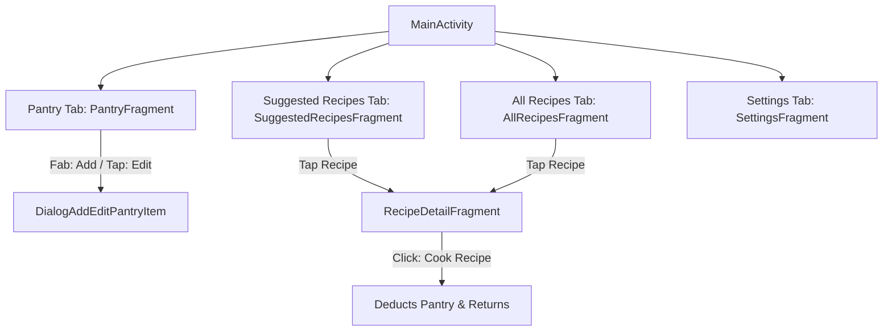
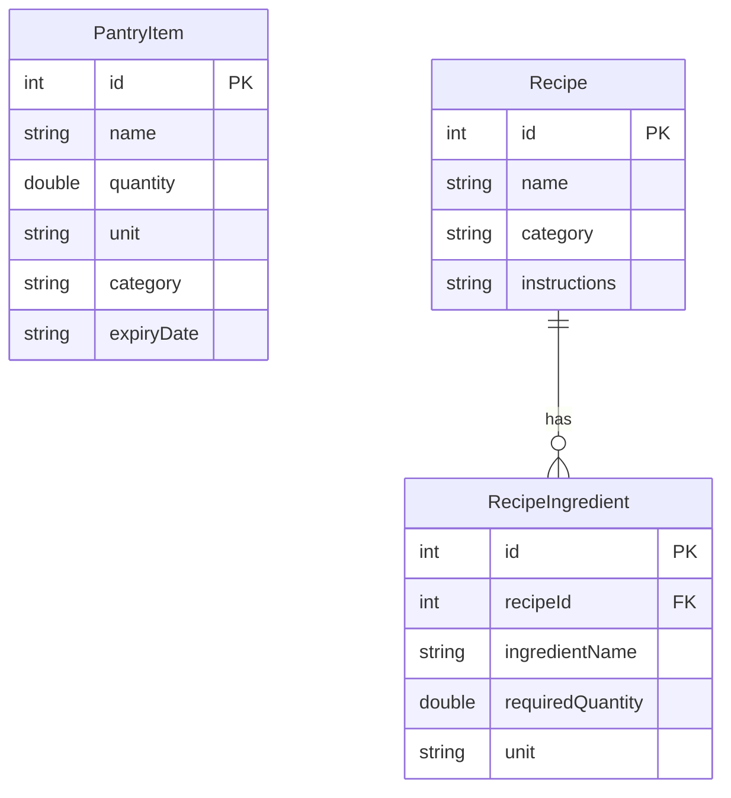

# Database Architecture, Screen Flow, and Top Code Snippets

---

## 1. Database Selection: Purpose & Reasoning

For the **SmartPantryManager**, the **Room Persistence Library** (built on top of SQLite) was chosen as the local database solution.

### Why Room over Raw SQLite or Cloud/NoSQL (Firestore):
1. **Local-First & Offline Functionality**: A pantry management application is an essential personal utility. Users need instant access to their inventory and recipe suggestions even without internet connectivity or user accounts. Local SQLite storage guarantees 100% offline availability.
2. **Compile-Time SQL Verification**: Unlike raw `SQLiteOpenHelper`, Room inspects SQL queries at compile time, catching syntax errors, missing columns, or typo mistakes before the app ever runs.
3. **First-Class LiveData / Flow Reactivity**: Room natively integrates with Android Architecture Components. DAOs can return `LiveData` or `Flow`, allowing ViewModels and UI fragments to observe database changes reactively. When an item is added, updated, or deleted, the UI updates instantly without manual polling.
4. **Clean Abstraction & Zero Boilerplate**: Room eliminates tedious boilerplate code (such as manual `Cursor` parsing and connection management) using intuitive annotations (`@Entity`, `@Dao`, `@Database`, `@Relation`).

---

## 2. Screen Flow & Database ER Diagrams

### Screen Flow / Wireframe Diagram (Mermaid)


### Database Entity-Relationship (ER) Diagram (Mermaid)


---

## 3. Top 5 Code Snippets with Purpose & Design Rationale

### Snippet 1: Room Database & Background Pre-seeding (`AppDatabase.java`)
**Purpose**: Initializes the singleton Room database instance and pre-seeds 20 diverse recipes and comprehensive pantry items on first database creation.
```java
private static final Callback sRoomDatabaseCallback = new Callback() {
    @Override
    public void onCreate(@NonNull SupportSQLiteDatabase db) {
        super.onCreate(db);
        databaseWriteExecutor.execute(() -> {
            seedAllData(INSTANCE.pantryDao(), INSTANCE.recipeDao());
        });
    }
};
```
* **Why written this way**: Database creation happens on a background thread. Using Room's `Callback.onCreate()` combined with `databaseWriteExecutor` ensures that pre-population runs off the main thread the very first time the app is installed, preventing ANR (Application Not Responding) errors.

---

### Snippet 2: Robust Recipe Matching & Pluralism (`StrictRecipeMatcher.java`)
**Purpose**: Analyzes pantry stock against recipe requirements with robustness to pluralism (`"tomato"` vs `"tomatoes"`), unit spelling, and unit conversions (grams/kg, ml/liters, loaves/slices).
```java
public static String normalizeName(String name) {
    if (name == null) return "";
    String norm = name.trim().toLowerCase(Locale.US).replaceAll("\\s+", " ");
    if (norm.endsWith("es") && norm.length() > 3) {
        norm = norm.substring(0, norm.length() - 2);
    } else if (norm.endsWith("s") && !norm.endsWith("ss") && norm.length() > 3) {
        norm = norm.substring(0, norm.length() - 1);
    }
    return norm;
}
```
* **Why written this way**: Real-world user input and recipe descriptions vary in phrasing (e.g., singular vs. plural). Reducing words to their base singular stem and handling unit conversions (`1 loaf` = `20 slices`) ensures accurate matching without breaking on trivial differences.

---

### Snippet 3: Performant RecyclerView ListAdapter (`RecipeAdapter.java`)
**Purpose**: Efficiently renders dynamic lists of recipes with animations and minimal layout recalculations.
```java
private static final DiffUtil.ItemCallback<RecipeWithIngredients> DIFF_CALLBACK = new DiffUtil.ItemCallback<>() {
    @Override
    public boolean areItemsTheSame(@NonNull RecipeWithIngredients oldItem, @NonNull RecipeWithIngredients newItem) {
        return oldItem.getRecipe() != null && newItem.getRecipe() != null
                && oldItem.getRecipe().getId() == newItem.getRecipe().getId();
    }

    @Override
    public boolean areContentsTheSame(@NonNull RecipeWithIngredients oldItem, @NonNull RecipeWithIngredients newItem) {
        // Compares contents to determine precise UI updates
        ...
    }
};
```
* **Why written this way**: Extending `ListAdapter` with `DiffUtil` computes list differences asynchronously on a background thread. This avoids full-list `notifyDataSetChanged()` re-renders and provides buttery-smooth animations when filtering or updating pantry stock.

---

### Snippet 4: Reactive MediatorLiveData (`RecipesViewModel.java`)
**Purpose**: Combines multiple reactive data sources (all recipes, pantry inventory, search queries, category filters) to automatically update strict suggestions and "Almost There" recipes in real-time.
```java
suggestedRecipesLiveData.addSource(allRecipes, recipes -> updateSuggestedRecipes());
suggestedRecipesLiveData.addSource(allPantryItems, pantry -> updateSuggestedRecipes());
suggestedRecipesLiveData.addSource(searchQuery, query -> updateSuggestedRecipes());
suggestedRecipesLiveData.addSource(categoryFilter, category -> updateSuggestedRecipes());
```
* **Why written this way**: `MediatorLiveData` enables listening to multiple LiveData streams simultaneously. Whenever pantry inventory changes or search filters are applied, suggestions recalculate instantly and reactively.

---

### Snippet 5: Robust Input Validation on Data Entry (`PantryFragment.java`)
**Purpose**: Validates user inputs before persisting new or updated pantry items.
```java
dialog.setOnShowListener(d -> {
    dialog.getButton(AlertDialog.BUTTON_POSITIVE).setOnClickListener(v -> {
        String name = dialogBinding.etName.getText().toString().trim();
        String qtyStr = dialogBinding.etQuantity.getText().toString().trim();
        boolean isValid = true;

        if (name.isEmpty()) {
            dialogBinding.tilName.setError("Name is required");
            isValid = false;
        }
        ...
        if (!isValid) return;
        // Proceed with CRUD insert/update
        dialog.dismiss();
    });
});
```
* **Why written this way**: Overriding the `AlertDialog` positive button click listener prevents the dialog from dismissing automatically when validation fails. It highlights invalid fields with inline `TextInputLayout` errors (`setError(...)`), ensuring high data integrity.
